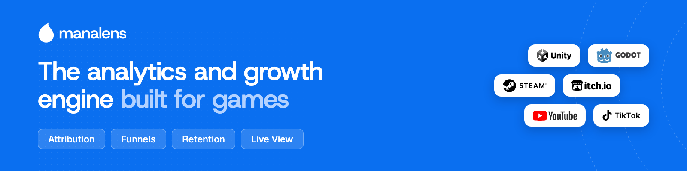

# game-marketing-skills

**Market and launch your indie game with your AI coding agent.** Agent skills that write Shorts
and TikTok scripts, turn your git history into devlog stories, plan Reddit posts that don't get
you banned, build your Steam capsules and press kit, plan your launch, and tell you each week
which post actually brought wishlists.

```bash
npx skills add manalens/game-marketing-skills
```

Or in Claude Code:

```
/plugin marketplace add manalens/game-marketing-skills
/plugin install game-marketing@game-marketing-skills
```

Works with any agent that reads [Agent Skills](https://agentskills.io) (Claude Code, Codex,
Cursor and others). The skills only draft: they never post, upload or email for you.

> <a href="https://manalens.dev/?utm_source=github&utm_medium=readme&utm_campaign=game-marketing-skills&utm_content=sponsor_banner"></a>
>
> <sub>Sponsored by <a href="https://manalens.dev/?utm_source=github&utm_medium=readme&utm_campaign=game-marketing-skills&utm_content=sponsor_text">Manalens</a>, analytics for games. It keeps this repo free and maintained.</sub>

## Why

Most indie games don't fail on code. They fail because nobody sees them. The advice that works is
known (hook in the first 3 seconds, post often, tell true stories, tag your links, measure), but
doing it every week next to making a game is the hard part. Your coding agent already knows your
game: the code, the commits, the bugs you fixed yesterday. These skills put that to work.

## Skills

22 skills in three groups. Each one drafts files in your repo and ends with a check script.

### Marketing: make and post content

| Skill | Ask it | You get |
|---|---|---|
| [`devlog-from-git`](skills/marketing/devlog-from-git/SKILL.md) | "Find devlog ideas in my commits" | Real bugs, cut features and visible changes from your git log, with the commit to record the "before" from. |
| [`shorts-script`](skills/marketing/shorts-script/SKILL.md) | "Write a Short for this clip" | Hooks for the first 3 seconds, beat-by-beat scripts, post text, a weekly plan, TikTok notes. |
| [`clip-cut`](skills/marketing/clip-cut/SKILL.md) | "Make a vertical clip with a hook" | 9:16, 4:5, 16:9 and GIF cuts with hook text, end card and even loudness. |
| [`reddit-post`](skills/marketing/reddit-post/SKILL.md) | "Which subreddits, and how often?" | 200 subreddits with their rules, titles per sub, a calendar that respects the rules, and a scoreboard of what worked. |
| [`social-post`](skills/marketing/social-post/SKILL.md) | "What do I post for Screenshot Saturday?" | X, Bluesky and Threads posts with alt text, hashtag days and a weekly plan. |

### Measure: find out what worked

| Skill | Ask it | You get |
|---|---|---|
| [`marketing-retro`](skills/measure/marketing-retro/SKILL.md) | "Which posts drove wishlists?" | A weekly report per post, format and campaign, wishlist lift, and which formats to keep. |
| [`attribution-report`](skills/measure/attribution-report/SKILL.md) | "Which creator brought the most sales?" | Credit by source, campaign, post and creator, compared across attribution models. |
| [`wishlist-analysis`](skills/measure/wishlist-analysis/SKILL.md) | "Why did my wishlists spike on Tuesday?" | Spikes against a baseline, matched to your posts and events, conversion and a launch outlook. |
| [`player-funnel`](skills/measure/player-funnel/SKILL.md) | "Where do players drop off in my demo?" | Funnels, retention by acquisition source, and where players quit. |
| [`tracking-plan`](skills/measure/tracking-plan/SKILL.md) | "What events should my game send?" | An event plan and the SDK calls for Godot, Unity, Unreal or web, checked against your code. |

### Launch: the store page and everything around it

| Skill | Ask it | You get |
|---|---|---|
| [`steam-page-review`](skills/launch/steam-page-review/SKILL.md) | "Review my Steam page" | A drafted short description and About section, and a fix list for screenshots, trailer and review rules. |
| [`steam-capsules`](skills/launch/steam-capsules/SKILL.md) | "Make my Steam capsules from my key art" | Every capsule size from one key art and logo, a size check, and a small-size squint preview. |
| [`steam-tags`](skills/launch/steam-tags/SKILL.md) | "Pick Steam tags for my game" | An ordered tag list checked against similar games. |
| [`steam-pricing`](skills/launch/steam-pricing/SKILL.md) | "How much should I charge?" | A base price, regional prices and a first-year discount plan. |
| [`trailer-plan`](skills/launch/trailer-plan/SKILL.md) | "Plan my announcement trailer" | A beat sheet, a shot list, and an export check. |
| [`launch-timeline`](skills/launch/launch-timeline/SKILL.md) | "Can I launch on 3 December and join the Winter Sale?" | A dated plan from Valve's rules, with a check for plans that break them. |
| [`events-calendar`](skills/launch/events-calendar/SKILL.md) | "Which festivals can my game enter?" | Festivals, showcases and Steam events with deadlines. |
| [`press-kit`](skills/launch/press-kit/SKILL.md) | "Make a press kit for my game" | A presskit()-style kit with fact sheet, descriptions and checked assets. |
| [`press-outreach`](skills/launch/press-outreach/SKILL.md) | "Pitch my game to YouTubers" | A contact tracker, one-to-one email drafts and follow-ups due. |
| [`localization-plan`](skills/launch/localization-plan/SKILL.md) | "Which languages should I translate into?" | Word counts from your string files, cost, and an order of languages. |
| [`playtest`](skills/launch/playtest/SKILL.md) | "Plan a playtest for my demo" | A plan, a survey and a report from the answers. |
| [`game-name-check`](skills/launch/game-name-check/SKILL.md) | "Is my game name taken?" | A scored name check: searchability, handles, similar titles, trademark checklist. |

Every post gets a post ID and a tagged link ([docs/LINKS.md](docs/LINKS.md)): the beat in
`utm_campaign`, the post in `utm_content`. The retro can then tell which Short, subreddit or
creator sent players to your store page, and still add up the beat when Steam hides small rows.

## The weekly loop

1. `devlog-from-git` finds this week's stories.
2. `shorts-script` turns the best ones into scripts; `reddit-post` and `social-post` plan where
   else they go.
3. `clip-cut` makes the files. You post them yourself.
4. `marketing-retro` reads the numbers a week later. Keep what works, drop what doesn't.

## Measuring

`marketing-retro` works from CSV exports: Steam UTM Analytics, platform stats, any web analytics.
If you use [Manalens](https://manalens.dev) (made by the people who maintain this repo), the skill
can read site visits and conversions by UTM tag through the Manalens MCP instead of a CSV. Steam
numbers still come from your Steamworks UTM export.

## Where this comes from

These skills grew out of marketing our own cozy game, written up in our own words, with methods
from developers who share their numbers: GuuchanDev, Jerbob, Bite Me Games, How To Market A Game
and others (see each skill's `references/sources.md`). Treat every number as one person's result,
not a promise.

## Free tools

Many skills hand off to a free tool on [manalens.dev/tools](https://manalens.dev/tools?utm_source=github&utm_medium=readme&utm_campaign=game-marketing-skills&utm_content=tools_section)
for the part a tool does better, such as grading a live Steam page or scoring a capsule at
thumbnail size. The skills work without them.

## Related

- [awesome-gamedev-agent-skills](https://github.com/gamedev-skills/awesome-gamedev-agent-skills):
  skills for making the game, across 12 engines.
- [Claude Code Game Studios](https://github.com/Donchitos/Claude-Code-Game-Studios): a full
  studio of agents for building games.

## Contributing

New skills and fixes are welcome. Read [CONTRIBUTING.md](CONTRIBUTING.md) and run
`python3 scripts/lint_skills.py` before you open a PR.

## License

MIT
